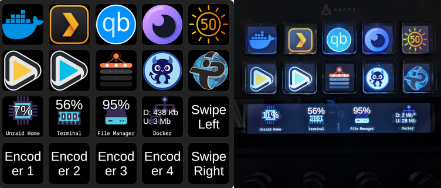
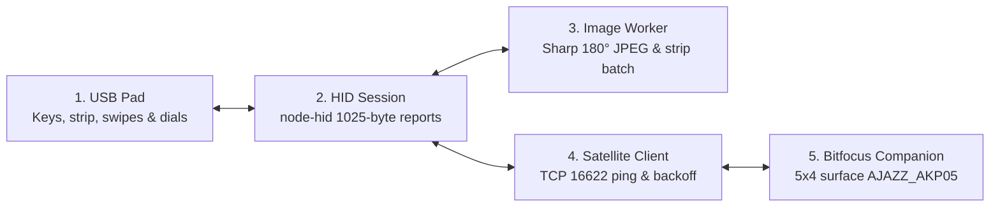

<p align="center"></p>

# Ajazz / Mirabox Companion Bridge

*Use your Ajazz AKP05E or Mirabox LCD button pad with [Bitfocus Companion](https://bitfocus.io/companion).*

Ajazz Companion Bridge connects an Ajazz or Mirabox USB macro pad to Bitfocus Companion through Companion's Satellite API (`16622`). It renders Companion's 112×112 button graphics on the 10 LCD keys and wide touch strip, and sends key presses, touch-strip taps, swipes and rotary dial turns back to Companion. It runs on Windows, Unraid, Docker, macOS and Linux, and reconnects on its own if the pad is unplugged or Companion restarts.

Setup guide: [docs/README.md](docs/README.md)


*Figure 1: An Ajazz AKP05E running Companion buttons across the 10 LCD keys and four-zone touch strip.*

## Where to find each task

| If you want to | Go to |
|---|---|
| Check supported pads and prepare Companion's Satellite API | [Chapter 1: Before you start](docs/01-before-you-start.md) |
| Install on Windows from the ready-to-run zip or `setup.cmd` | [Chapter 2: Install on Windows](docs/02-install-ajazz-companion-bridge.md#21-install-on-windows) |
| Install on Unraid without Privileged mode | [Chapter 2: Install on Unraid](docs/02-install-ajazz-companion-bridge.md#22-install-on-unraid) |
| Install with Docker Compose, macOS or Linux (`udev`) | [Chapter 2: Docker, macOS and Linux](docs/02-install-ajazz-companion-bridge.md#24-install-with-docker-compose-macos-or-linux) |
| Map the 10 LCD keys, 4 touch zones, swipes and 4 dials | [Chapter 3: Set up buttons in Companion](docs/03-set-up-buttons-in-companion.md) |
| Keep Companion private and update without losing `.env` | [Chapter 4: Keep Ajazz Companion Bridge safe](docs/04-keep-ajazz-companion-bridge-safe.md) |
| Fix a dark pad, `Companion offline` or torn button images | [Chapter 5: Troubleshooting](docs/05-troubleshooting.md) |
| Look up every `.env` and container setting | [Appendix B: Settings reference](docs/appendix-b-settings-reference.md) |
| Check USB IDs or verify an experimental pad with `npm run probe` | [Supported devices (`docs/DEVICES.md`)](docs/DEVICES.md) |
| Understand the module layout and USB / Satellite data flow | [Architecture (`docs/ARCHITECTURE.md`)](docs/ARCHITECTURE.md) |

**Reading paths.** First-time installers start at the [Ajazz Companion Bridge setup guide](docs/README.md) and read Chapters 1 to 4 in order. Returning readers use the table above to jump to a button mapping, setting, update step or fix.

## How it works

Five stages move each button press and bitmap between your USB pad and Bitfocus Companion:



In order: **USB Pad** sends raw `ACK` input reports over USB, and **HID Session** translates them into button presses, synthetic releases (`50` ms) and rotary ticks. **Satellite Client** forwards those events over TCP port `16622` to **Bitfocus Companion** and receives `KEY-STATE` bitmaps back. **Image Worker** rotates key graphics 180°, composites the four touch-strip icons into one 800×112 banner, and streams the JPEG packets back to the pad.

## Visual tour

### 1. Prepare Bitfocus Companion

Before starting the bridge, enable Companion's **Satellite API** on port `16622` and turn **off** Companion's built-in **Enable connected Mirabox Stream Dock devices** toggle so the bridge can claim the USB pad.


*Figure 2: Companion settings with Satellite API enabled on port 16622 and Mirabox direct capture turned off. Illustration, not a live screenshot.*

### 2. Run from the Windows system tray

On Windows, the bridge runs silently in the system tray near the clock. Right-click the tray icon to see the connected pad and Companion status, open `bridge.log`, force a reconnect or toggle **Start at login**.


*Figure 3: The Windows system tray menu showing a connected AKP05E, Start at login enabled and Reconnect. Illustration, not a live screenshot.*

### 3. Run on Unraid or Docker without Privileged mode

When the pad is plugged into an Unraid server or Linux Docker host, pass only the pad's `/input0` `/dev/hidrawN` device node into the container (`ghcr.io/dvortsis/ajazz-companion-bridge:latest`) so **Privileged** stays off.


*Figure 4: The Unraid container template with Companion host, port 16622 and the USB HID device node. Illustration, not a live screenshot.*

## Which Companion button is which? (AKP05E)

In Companion, the Ajazz AKP05E registers as a 5-column by 4-row surface (`20` slots, numbered `row/column` starting at `0/0`):

| On the pad | Row in Companion | Buttons (`row/col`) | Notes |
|---|---|---|---|
| Top row of 5 LCD keys | Row 0 | `0/0` … `0/4` | Full press/release; 112×112 key graphics |
| Middle row of 5 LCD keys | Row 1 | `1/0` … `1/4` | Full press/release; 112×112 key graphics |
| Touch strip (4 touch buttons) | Row 2 | `2/0` … `2/3` | Tap sends a click; shows 4 icons aligned over the dials |
| Swipe strip to the left | Row 2 | `2/4` | Swiping left triggers button `2/4` |
| Four rotary dials (left to right) | Row 3 | `3/0` … `3/3` | Enable **Rotary Actions** in Companion for left/right turns; push clicks |
| Swipe strip to the right | Row 3 | `3/4` | Swiping right triggers button `3/4` |

## Quick start

> [!IMPORTANT]
> Run the bridge on the computer the USB pad is plugged into. In Companion, turn **Settings** > **Satellite API** **on** (`16622`) and turn **Settings** > **Surfaces** > **Enable connected Mirabox Stream Dock devices** **off** before starting the bridge.

### Ready-to-run downloads (no Node.js needed)

Every release on the [Releases page](https://github.com/dvortsis/ajazz-companion-bridge/releases) includes a portable bundle with Node.js and native USB modules pre-packaged:

| Operating system | Release bundle | Start command or launcher |
|---|---|---|
| **Windows (x64) (recommended)** | `ajazz-bridge-<version>-windows-x64.zip` | Extract to `C:\Ajazz-Bridge` and double-click **`launch-bridge.vbs`** |
| macOS (Apple silicon M1+) | `ajazz-bridge-<version>-macos-arm64.tar.gz` | Clear quarantine (`xattr -dr com.apple.quarantine <folder>`), then open **`Start Ajazz Bridge.command`** |
| macOS (Intel) | `ajazz-bridge-<version>-macos-x64.tar.gz` | Clear quarantine (`xattr -dr com.apple.quarantine <folder>`), then open **`Start Ajazz Bridge.command`** |
| Linux (x64) | `ajazz-bridge-<version>-linux-x64.tar.gz` | Install `deploy/linux/99-ajazz-bridge.rules`, replug the pad and run `./start.sh` |

### Windows from source (`setup.cmd`)

If you downloaded the repository source instead of a release bundle, install [Node.js 20 LTS or newer](https://nodejs.org/), extract the project to `C:\Ajazz-Bridge`, double-click **`setup.cmd`** once, and launch with **`launch-bridge.vbs`**.

### Docker Compose

On a Linux Docker host with the pad plugged in and `deploy/linux/99-ajazz-bridge.rules` installed, run this in a terminal inside the repository folder:

```bash
docker compose up -d
```

See [Chapter 2](docs/02-install-ajazz-companion-bridge.md) and [`docs/PLATFORMS.md`](docs/PLATFORMS.md) for the Unraid `/input0` hidraw lookup command, systemd user services and macOS LaunchAgents.

## Common settings

Most setups work with the defaults. To change a setting on desktop installs, edit `.env` in the bridge folder and restart the bridge from the tray menu:

| Setting | Default | What it does |
|---|---|---|
| `COMPANION_HOST` | `127.0.0.1` | IP address or hostname of the computer running Companion |
| `COMPANION_PORT` | `16622` | Companion Satellite API TCP port |
| `HID_WRITE_DELAY_MS` | `0` | Pause (ms) between USB image packets; try `1`, `2` or `5` if icons look torn |
| `AKP05_STRIP_EDGE_PADDING` | `8` | Black edge margin (px) on the touch strip so the 4 icons sit over the 4 dials |
| `BRIDGE_SHIFT_ROTATE` | `0` | Set `1` to send held-down dial turns to a 5th Companion row (`4/0`–`4/3`) |
| `LOG_LEVEL` | `info` | Set `debug` when collecting `bridge.log` for a bug report |

See [Appendix B: Settings reference](docs/appendix-b-settings-reference.md) and [`docs/CONFIGURATION.md`](docs/CONFIGURATION.md) for all 31 settings.

## Reference and guides

- **Textbook setup and safety guide:** [`docs/README.md`](docs/README.md) ([Glossary](docs/glossary.md) · [Index](docs/index.md) · [Shot list](docs/images/SHOTLIST.md))
- **Step-by-step Windows walkthrough:** [`docs/GETTING-STARTED.md`](docs/GETTING-STARTED.md)
- **Platform notes (macOS, Linux, Docker, Unraid):** [`docs/PLATFORMS.md`](docs/PLATFORMS.md)
- **Full `.env` configuration reference:** [`docs/CONFIGURATION.md`](docs/CONFIGURATION.md)
- **Supported and experimental USB pads:** [`docs/DEVICES.md`](docs/DEVICES.md)
- **Troubleshooting quick checks:** [`docs/TROUBLESHOOTING.md`](docs/TROUBLESHOOTING.md)
- **System architecture and module map:** [`docs/ARCHITECTURE.md`](docs/ARCHITECTURE.md)
- **Contributing and release history:** [`CONTRIBUTING.md`](CONTRIBUTING.md), [`CHANGELOG.md`](CHANGELOG.md)

## Credits and licence

Built on the USB protocol reverse-engineering work of [ambiso/opendeck-akp05](https://github.com/ambiso/opendeck-akp05) and [4ndv/mirajazz](https://github.com/4ndv/mirajazz). Free to use under the [MIT License](LICENSE).
