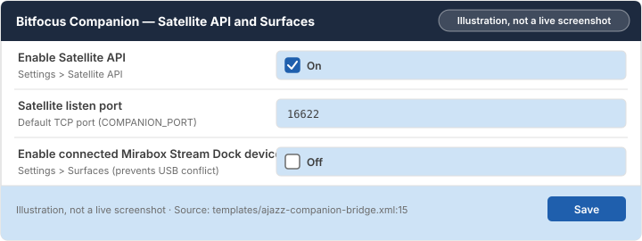

# Chapter 1: Before you start

Prepare [Companion](glossary.md#companion) for the bridge and pick the install method that matches the computer your pad is plugged into.

> [!NOTE]
> **What you will learn**
> - Check whether your USB pad is hardware-verified or experimental.
> - Choose the install method for the machine holding the USB cable.
> - Turn on the [Satellite API](glossary.md#satellite-api) and stop Companion from claiming the pad directly.

## 1.1 Check your pad and how the bridge works

<!-- index: Ajazz AKP05E; supported devices; USB pad -->

The bridge runs on the computer or server the pad is plugged into over USB. It draws Companion's button pictures on the pad's screens and sends key presses, [touch strip](glossary.md#touch-strip) taps, swipes and dial turns to Companion over your network.

The **Ajazz AKP05E** (USB ID `0300:3004`) is tested on real hardware on Windows and Unraid 7.3.2. Other Ajazz and Mirabox models in [`DEVICES.md`](DEVICES.md) are experimental profiles.

## 1.2 Choose an install method

<!-- index: install method; Windows; Unraid; Docker Compose -->

Always install the bridge on the machine where the pad's USB cable is plugged in. Companion itself can run on the same machine or on another computer on your home network.

| Option | When to use it |
|---|---|
| **Windows portable zip (recommended)** | The pad is plugged into a Windows PC. No Node.js install is needed. |
| Unraid template | The pad is plugged directly into an Unraid server USB port. |
| Docker Compose | The pad is plugged into a Linux home server that runs Docker. |
| macOS or Linux bundle | The pad is plugged into a Mac or Linux desktop PC. |
| Source install (`setup.cmd` or `npm`) | You want to edit the code or run `npm run probe` to test an experimental pad. |

## 1.3 Prepare Bitfocus Companion

<!-- index: Satellite API; Mirabox Stream Dock; surfaces -->

Before starting the bridge, turn on Companion's network listener and stop Companion's built-in Mirabox driver from grabbing the pad first. Each connected keypad in Companion is called a [surface](glossary.md#surface).

To prepare Companion for the bridge:

1. Open Companion in your browser (by default `http://127.0.0.1:8000` on the Companion machine).
2. Select **Settings**, then open **Satellite API**.
3. Switch **Enable Satellite API** on and leave the port at `16622`.
   **Result:** Companion listens on TCP port `16622` for external surfaces.
4. Select **Settings**, then open **Surfaces**.
5. Switch **Enable connected Mirabox Stream Dock devices** off.
   **Result:** Companion releases USB access so the bridge can open the pad.

*Figure 1.1: Companion settings with Satellite API enabled on port 16622 and Mirabox direct capture turned off. Illustration, not a live screenshot.*

> [!WARNING]
> Don't leave **Enable connected Mirabox Stream Dock devices** turned on in Companion. Companion grabs the USB pad for itself and the bridge stays dark; switch that option off instead.

## 1.4 Check your understanding

1. Your pad is plugged into your Windows PC, and Companion runs on your Unraid server. Which machine runs the bridge?
2. Which two settings do you change in Companion before starting the bridge?

> [!TIP]
> **Key takeaways**
> - Run the bridge on the machine the USB pad is plugged into.
> - Turn **Enable Satellite API** on (port `16622`) in Companion.
> - Turn **Enable connected Mirabox Stream Dock devices** off under **Settings** > **Surfaces**.

<!-- nav:start -->
---

[← Ajazz Companion Bridge setup guide](README.md) · [Contents](README.md#contents) · [Chapter 2: Install the bridge on your machine →](02-install-ajazz-companion-bridge.md)
<!-- nav:end -->
