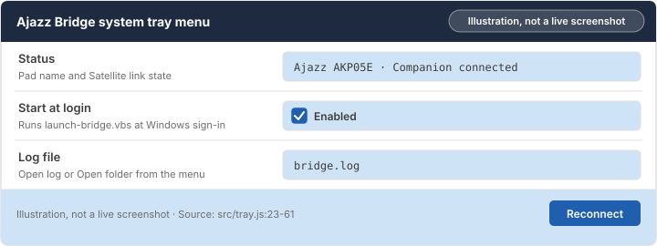
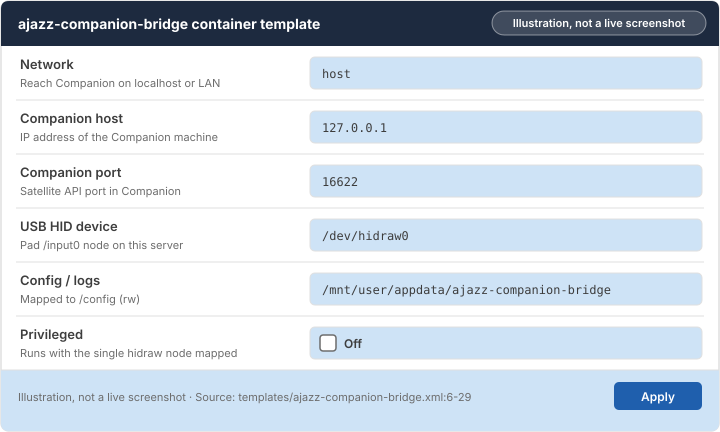

# Chapter 2: Install the bridge on your machine

Install the bridge on the machine holding your USB pad and connect it to [Companion](glossary.md#companion).

> [!NOTE]
> **What you will learn**
> - Run the bridge on Windows from the portable zip or `setup.cmd`.
> - Install the [container](glossary.md#container) on Unraid with the pad's `/input0` [hidraw](glossary.md#hidraw) device mapped.
> - Set each Unraid template field to its safe value without Privileged mode.
> - Install on Docker Compose, macOS or Linux with [udev rules](glossary.md#udev-rules).

## 2.1 Install on Windows

<!-- index: Windows; launch-bridge.vbs; setup.cmd; system tray -->

On Windows, the release zip on GitHub already includes Node.js and all dependencies. Extract it to a permanent folder such as `C:\Ajazz-Bridge`, not `Downloads` or `Temp`.

To install from the Windows portable bundle:

1. Download `ajazz-bridge-<version>-windows-x64.zip` from the project's **Releases** page and extract it to `C:\Ajazz-Bridge`.
2. Plug your USB pad directly into the PC.
3. Open `C:\Ajazz-Bridge` and double-click **`launch-bridge.vbs`**.
   **Result:** An icon appears in the [system tray](glossary.md#system-tray) near the clock, and your pad lights up with Companion buttons within a few seconds.
4. Right-click the tray icon and select **Start at login** if you want the bridge to launch when you sign in.
   **Result:** A checkmark appears next to **Start at login**.


*Figure 2.1: The system tray menu showing a connected AKP05E, Start at login enabled and Reconnect. Illustration, not a live screenshot.*

<details>
<summary>Installing from source on Windows with setup.cmd</summary>

If you downloaded the source code zip instead of the release bundle, install Node.js 20 LTS or newer from `nodejs.org`. Extract the source to `C:\Ajazz-Bridge` and double-click **`setup.cmd`**. It copies `.env.example` to `.env`, runs `npm install --omit=dev`, and asks whether to enable startup at login. Then double-click **`launch-bridge.vbs`**.

</details>

## 2.2 Install on Unraid

<!-- index: Unraid; hidraw; USB HID device; template -->

Use this route only when the USB pad is plugged physically into the Unraid server. The pad creates two `/dev/hidrawN` entries on Linux; the bridge needs the first one, whose `HID_PHYS` ends in `/input0`.

To find the pad's device node and install on Unraid:

1. Plug the pad into the Unraid server and open the Unraid terminal (the **>_** icon at the top right).
2. In the Unraid terminal, paste:

   ```bash
   for d in /sys/class/hidraw/hidraw*; do grep -q 00000300:00003004 $d/device/uevent && echo "$(basename $d) $(grep HID_PHYS $d/device/uevent)"; done
   ```

   **Result:** Two lines appear, such as `hidraw7 ... /input0` and `hidraw8 ... /input1`. Note the `/input0` name (for example `/dev/hidraw7`).
3. In the Unraid terminal, paste this command to add the template:

   ```bash
   wget -O /boot/config/plugins/dockerMan/templates-user/ajazz-companion-bridge.xml https://raw.githubusercontent.com/dvortsis/ajazz-companion-bridge/main/templates/ajazz-companion-bridge.xml
   ```

   **Result:** Unraid saves `ajazz-companion-bridge.xml` in your user templates folder.
4. Open the **Docker** tab, select **Add Container**, and choose **ajazz-companion-bridge** under **User templates**.
5. Set **Companion host** to the IP address of the machine running Companion, and set **USB HID device** to the `/input0` path from step 2.
6. Select **Apply**.
   **Result:** Unraid pulls the image and starts the container. The container log shows `[HID] Secured` and `ADD-DEVICE OK`.


*Figure 2.2: Unraid template fields with Companion host, Satellite port 16622 and the USB HID device node. Illustration, not a live screenshot.*

## 2.3 Template fields and options

<!-- index: template fields; COMPANION_HOST; appdata; host mode -->

Keep the defaults unless a field below says to change it. Advanced fields appear when you toggle **Basic View** to **Advanced View**.

### Companion host

The IP address or hostname of the computer running Companion (`COMPANION_HOST`).

**Recommended:** `127.0.0.1` when Companion runs on the same PC or in [host mode](glossary.md#host-mode) on the same server. If Companion runs on another machine or in its own bridge network, enter that machine's LAN IP (such as `192.168.1.50`).

**Safe to change later:** Yes. Edit `.env` or the container variable and restart the bridge.

### Companion port

The TCP port for Companion's [Satellite API](glossary.md#satellite-api) (`COMPANION_PORT`).

**Recommended:** `16622`, matching **Settings** > **Satellite API** in Companion.

### USB HID device

The Linux device path passed into the container (`--device=/dev/hidrawN`).

**Recommended:** The `/dev/hidrawN` node whose `HID_PHYS` ends in `/input0`. This lets the container run with **Privileged** off.

**Unsafe:** Turning **Privileged** on by default. Privileged mode gives the container access to every device on your server; pass the single `/dev/hidrawN` node instead.

### Config / logs

The [appdata](glossary.md#appdata) folder mapped to `/config` inside the container for `bridge.log` rotation.

**Recommended:** `/mnt/user/appdata/ajazz-companion-bridge` on Unraid, or `./config:/config` in Docker Compose.

### Network mode

How the container reaches Companion on the network.

**Recommended:** `host`. The bridge makes outbound connections only and opens no listening port.

| Mode | When to use it |
|---|---|
| **Host (recommended)** | Default in the template and `docker-compose.yml`. The bridge makes outbound connections only and opens no listening port. |
| Bridge | Companion runs on another machine or LAN IP and you set `COMPANION_HOST` to that IP. |

### USB write delay (ms)

Milliseconds paused between 1025-byte USB image packets (`HID_WRITE_DELAY_MS`).

**Recommended:** `0` for full speed. Raise to `1`, `2` or `5` only if button images look torn or half-drawn.

## 2.4 Install with Docker Compose, macOS or Linux

<!-- index: Linux; macOS; udev rules; Docker Compose -->

On Linux (both desktop and Docker hosts), install the USB permission rules first so non-root processes can open the pad.

To install on Linux or Docker Compose:

1. In a terminal on the Linux machine holding the pad, paste:

   ```bash
   sudo cp deploy/linux/99-ajazz-bridge.rules /etc/udev/rules.d/ && sudo udevadm control --reload && sudo udevadm trigger
   ```

   **Result:** Linux loads the permission rule for supported Ajazz and Mirabox USB IDs.
2. Unplug the USB pad and plug it back in.
   **Result:** The `/dev/hidrawN` node receives `uaccess` and `plugdev` permissions.
3. For Docker Compose, edit `devices:` in `docker-compose.yml` to match your `/input0` node, then in a terminal in the project folder paste:

   ```bash
   docker compose up -d
   ```

   **Result:** Docker starts `ajazz-bridge` in the background and writes logs to `./config/bridge.log`.

<details>
<summary>Running the macOS or Linux portable release bundle</summary>

On macOS, unpack `ajazz-bridge-<version>-macos-arm64.tar.gz` (or `x64`). Clear the download quarantine flag once in Terminal by running `xattr -dr com.apple.quarantine <folder-path>`, then double-click **`Start Ajazz Bridge.command`** and allow **Input Monitoring** if macOS asks. On Linux Desktop, unpack the `.tar.gz` after adding the udev rule and run `./start.sh` in a terminal.

</details>

## 2.5 Check your understanding

1. On Unraid, the terminal command shows `/dev/hidraw7` (`/input0`) and `/dev/hidraw8` (`/input1`). Which one goes into **USB HID device**?
2. Why does the Unraid template keep **Privileged** turned off?

> [!TIP]
> **Key takeaways**
> - Extract the Windows zip to a permanent folder such as `C:\Ajazz-Bridge`, never `Downloads`.
> - On Unraid and Docker, pass the `/input0` hidraw node so **Privileged** stays off.
> - On Linux, install `99-ajazz-bridge.rules` and replug the pad before starting.

<!-- nav:start -->
---

[← Chapter 1: Before you start](01-before-you-start.md) · [Contents](README.md#contents) · [Chapter 3: Set up buttons in Companion →](03-set-up-buttons-in-companion.md)
<!-- nav:end -->
