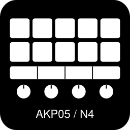

# Ajazz Companion Bridge setup guide

Connect an Ajazz or Mirabox USB button pad to Bitfocus Companion, set it up safely and keep it running.

## Who this guide is for

You can install an app from your Unraid app catalog, run a Windows launcher or paste a command when told where. You want your Ajazz AKP05E (or compatible Mirabox pad) to show Companion buttons and react to keys, touch zones, swipes and dials. This guide explains each setup choice and gives the safe answer.

## How to use this guide

Read the chapters in order the first time. Later, use the table below to jump to a task.

### Where to find each task

| If you want to | Go to |
|---|---|
| Check supported pads and turn on Companion's Satellite API | [Chapter 1](01-before-you-start.md) |
| Install the bridge on Windows, Unraid, Docker, macOS or Linux | [Chapter 2](02-install-ajazz-companion-bridge.md) |
| Map keys, touch zones, swipes and dials in Companion | [Chapter 3](03-set-up-buttons-in-companion.md) |
| Keep Companion and the bridge off the internet and update safely | [Chapter 4](04-keep-ajazz-companion-bridge-safe.md) |
| Fix a dark pad, torn icons or a missing USB device | [Chapter 5](05-troubleshooting.md) |
| Look up every `.env` and container setting | [Appendix B](appendix-b-settings-reference.md) |

**Reading paths.** First-time installers read Chapters 1 to 4 in order. Returning readers use the table above to jump to a button mapping, setting, update step or fix.

## Contents

<!-- contents:start -->
- [Chapter 1: Before you start](01-before-you-start.md)
  - [1.1 Check your pad and how the bridge works](01-before-you-start.md#11-check-your-pad-and-how-the-bridge-works)
  - [1.2 Choose an install method](01-before-you-start.md#12-choose-an-install-method)
  - [1.3 Prepare Bitfocus Companion](01-before-you-start.md#13-prepare-bitfocus-companion)
  - [1.4 Check your understanding](01-before-you-start.md#14-check-your-understanding)
- [Chapter 2: Install the bridge on your machine](02-install-ajazz-companion-bridge.md)
  - [2.1 Install on Windows](02-install-ajazz-companion-bridge.md#21-install-on-windows)
  - [2.2 Install on Unraid](02-install-ajazz-companion-bridge.md#22-install-on-unraid)
  - [2.3 Template fields and options](02-install-ajazz-companion-bridge.md#23-template-fields-and-options)
  - [2.4 Install with Docker Compose, macOS or Linux](02-install-ajazz-companion-bridge.md#24-install-with-docker-compose-macos-or-linux)
  - [2.5 Check your understanding](02-install-ajazz-companion-bridge.md#25-check-your-understanding)
- [Chapter 3: Set up buttons in Companion](03-set-up-buttons-in-companion.md)
  - [3.1 Map keys, touch strip, swipes and dials](03-set-up-buttons-in-companion.md#31-map-keys-touch-strip-swipes-and-dials)
  - [3.2 Optional drawing and input settings](03-set-up-buttons-in-companion.md#32-optional-drawing-and-input-settings)
  - [3.3 Check your understanding](03-set-up-buttons-in-companion.md#33-check-your-understanding)
- [Chapter 4: Keep Ajazz Companion Bridge safe](04-keep-ajazz-companion-bridge-safe.md)
  - [4.1 Keep Companion and the Satellite API private](04-keep-ajazz-companion-bridge-safe.md#41-keep-companion-and-the-satellite-api-private)
  - [4.2 Use least-privilege USB access](04-keep-ajazz-companion-bridge-safe.md#42-use-least-privilege-usb-access)
  - [4.3 Back up settings and update](04-keep-ajazz-companion-bridge-safe.md#43-back-up-settings-and-update)
  - [4.4 Share logs safely](04-keep-ajazz-companion-bridge-safe.md#44-share-logs-safely)
  - [4.5 Check your understanding](04-keep-ajazz-companion-bridge-safe.md#45-check-your-understanding)
- [Chapter 5: Troubleshooting](05-troubleshooting.md)
  - [5.1 Common problems](05-troubleshooting.md#51-common-problems)
  - [5.2 Probe a control and get help](05-troubleshooting.md#52-probe-a-control-and-get-help)
- [Appendix A: Answers to check your understanding](appendix-a-answers.md)
- [Appendix B: Settings reference](appendix-b-settings-reference.md)
- [Glossary](glossary.md)
- [Revisions](revisions.md)
- [Index](index.md)
<!-- contents:end -->

## What you need

- An **Ajazz AKP05E** pad (USB ID `0300:3004`, hardware-verified on Windows and Unraid 7.3.2) or an experimental Ajazz/Mirabox pad from [`DEVICES.md`](DEVICES.md).
- A Windows PC, Mac, Linux machine or Unraid server with the pad plugged in over USB.
- **Bitfocus Companion** 3.0 or newer running on the same machine or another computer on your home network.
- About 10 minutes. The ready-to-run release bundle and Docker image include Node.js; source installs need Node.js 20 or newer.

## About this guide

This guide covers Ajazz Companion Bridge 1.3.0. Last updated 2026-10-24. Facts come from [`templates/ajazz-companion-bridge.xml`](../templates/ajazz-companion-bridge.xml), [`docker-compose.yml`](../docker-compose.yml), [`Dockerfile`](../Dockerfile), [`.env.example`](../.env.example), [`setup.cmd`](../setup.cmd) and [`src/config.js`](../src/config.js), recorded in [`setup.facts.md`](setup.facts.md). Figures marked *Illustration, not a live screenshot* are generated from those source files; see [`images/SHOTLIST.md`](images/SHOTLIST.md) for the live captures that replace them.

<!-- nav:start -->
---

[Chapter 1: Before you start →](01-before-you-start.md)
<!-- nav:end -->
