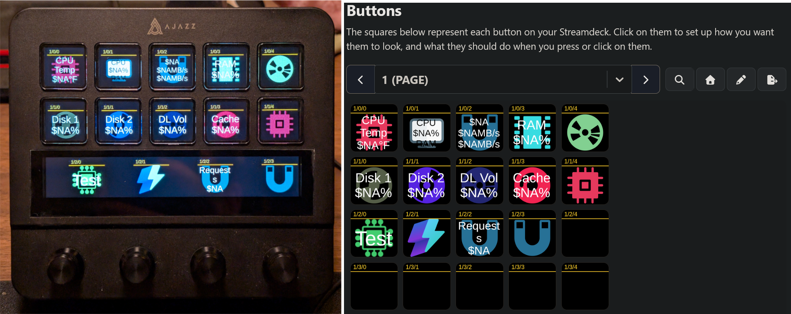

# Ajazz / Mirabox Companion Bridge

Use an Ajazz or Mirabox LCD macro pad as a native control surface for [Bitfocus Companion](https://bitfocus.io/companion), like an Elgato Stream Deck. The bridge reads the deck over USB, talks to Companion through its Satellite API, draws Companion's button images on the deck, and sends key presses, touch-strip taps, swipes and dial turns back.

- Main LCD keys, the ultra-wide **touch strip** (four zones composited into one image), **rotary dials** (rotate and push) and **swipes**.
- Runs on **Windows, macOS, Linux and Docker/Unraid**, with a tray / menu-bar icon where a desktop exists.
- Survives unplugging, Companion restarts and crashes: automatic reconnect, re-registration and supervisor restart.
- Several decks at once, USB hot-plug, rotating logs, and a `--probe` mode for verifying new devices.



## Supported devices

| Device                                                                   | USB id      | Status                                                                 |
| :----------------------------------------------------------------------- | :---------- | :--------------------------------------------------------------------- |
| **Ajazz AKP05E** (5x4 grid, registered with Companion as `AJAZZ_AKP05`)  | `0300:3004` | **Tested** on hardware: keys, touch strip, dials, swipes               |
| Ajazz AKP153 / 153E / 153R, AKP05E Pro, Mirabox N4 / N4E                 | see below   | Experimental, untested                                                 |
| AKP05 (3006), AKP05CN Pro, Mirabox N4 Pro, VSDinside N4, MSD Pro, others | see below   | Experimental: profiles from the reference projects, assumed AKP05-like |

Only the AKP05E on Windows has been tried on real hardware. The full list, how profiles work and how to verify a device are in [docs/DEVICES.md](docs/DEVICES.md).

## Quick start

1. **Companion:** open the web UI (usually `http://127.0.0.1:8000`) → **Settings** → **Satellite API** → enable it, port `16622`. Under **Settings** → **Surfaces**, switch **off** "Enable connected Mirabox Stream Dock devices" so Companion does not grab the deck itself.
2. **Install Node.js 20+** from [nodejs.org](https://nodejs.org/).
3. **Install the bridge** (the folder this readme is in):
   - Windows: double-click `setup.cmd` (installs dependencies, creates `.env`, offers start-at-login).
   - Anywhere: `npm install`, then copy `.env.example` to `.env`.
4. **Run:** `npm start` (or `node index.js`). The tray icon shows the deck and Companion connection status; the deck should light up and show your Companion page.

If Companion runs on another machine, set `COMPANION_HOST` in `.env`. The bridge always runs on the machine the deck is plugged into.

## Companion layout (AKP05E)

Companion sees the deck as a **5 × 4** grid (20 keys):

| Physical feature                 | Companion row | Buttons (row/col)                  |
| :------------------------------- | :------------ | :--------------------------------- |
| Top row of keys                  | 0             | `0/0` … `0/4`                      |
| Middle row of keys               | 1             | `1/0` … `1/4`                      |
| Touch strip (four zones)         | 2             | `2/0`, `2/1`, `2/2`, `2/3`         |
| Swipe left                       | 2             | `2/4` _(press)_                    |
| Rotary dials 1-4 (left to right) | 3             | `3/0` … `3/3` _(push, rotate L/R)_ |
| Swipe right                      | 3             | `3/4` _(press)_                    |

Assign dial turns in Companion's **Rotary Actions** tab on the dial's button (for example `3/0`). The four strip icons are spread across the 800 px strip, the outer two 8 px in from the edges, so each icon sits over its dial (`AKP05_STRIP_EDGE_PADDING` adjusts this):

```text
 |<-112->|                                                   |<-112->|
 +-------+     +-------+           +-------+     +-------+
 | key   |     | key   |           | key   |     | key   |      Companion keys 2/0  2/1  2/2  2/3
 | 2/0   |     | 2/1   |           | 2/2   |     | 2/3   |      (touch_1 ... touch_4)
 +-------+     +-------+           +-------+     +-------+
 x=8           x=232               x=456         x=680          icon left edges on the 800 px strip
    (o)           (o)                 (o)           (o)         dial 1       dial 2        dial 3       dial 4
```

## Running it everywhere

| Platform            | Setup                                                                                                           | Start at login                                      |
| :------------------ | :-------------------------------------------------------------------------------------------------------------- | :-------------------------------------------------- |
| **Windows**         | `setup.cmd` or `npm install`                                                                                    | `npm run install-startup` (Startup-folder launcher) |
| **macOS**           | `npm install`; allow _Input Monitoring_ if macOS asks                                                           | `npm run install-startup` (launchd agent)           |
| **Linux**           | `npm install`; `node scripts/udev-rules.js \| sudo tee /etc/udev/rules.d/99-ajazz-bridge.rules`, reload, replug | `npm run install-startup` (systemd user service)    |
| **Docker / Unraid** | `docker compose up -d`, or the Unraid template in `deploy/unraid/`                                              | container restart policy                            |

Step-by-step instructions, USB permissions and container passthrough are in [docs/PLATFORMS.md](docs/PLATFORMS.md). A portable Windows bundle that needs no Node install can be built with `npm run package`.

## Configuration

Everything is optional and set in `.env` (or environment variables in a container). The common ones:

| Setting                             | Default               | Purpose                                                               |
| :---------------------------------- | :-------------------- | :-------------------------------------------------------------------- |
| `COMPANION_HOST` / `COMPANION_PORT` | `127.0.0.1` / `16622` | Where Companion's Satellite API is                                    |
| `HID_WRITE_DELAY_MS`                | `0`                   | Raise to `1`, `2`, `5` if buttons look torn or half drawn             |
| `LOG_LEVEL`                         | `info`                | `debug` logs every frame and packet                                   |
| `BRIDGE_NO_TRAY`                    | auto                  | `1` hides the tray icon (default on headless Linux and in containers) |

Per-key dimming, idle dim/off, dial acceleration, press-and-rotate, swipe swap, timings and the rest are listed in [docs/CONFIGURATION.md](docs/CONFIGURATION.md) and annotated in `.env.example`. Unknown or invalid settings are reported in the log at startup.

## Troubleshooting

| Symptom                                  | What to do                                                                                                                       |
| :--------------------------------------- | :------------------------------------------------------------------------------------------------------------------------------- |
| Deck does not light up                   | Close the manufacturer's software; only one program should own the device. On Linux install the udev rules.                      |
| Companion says "Device exists elsewhere" | Another copy of the bridge (or Companion's own Mirabox driver) holds that id. Quit the other copy and disable the native driver. |
| Tray says "Companion offline"            | Check `COMPANION_HOST`, `COMPANION_PORT` and that the Satellite API is enabled.                                                  |
| Buttons tear or draw halfway             | Raise `HID_WRITE_DELAY_MS`.                                                                                                      |
| A control does nothing                   | Run `npm run probe`, press it, and compare the report with `parser.js`; attach the output to an issue.                           |
| Need more detail                         | Set `LOG_LEVEL=debug`, reproduce, then open the log from the tray menu (or `bridge.log` in the bridge folder).                   |

## Documentation

- [docs/PLATFORMS.md](docs/PLATFORMS.md): Windows, macOS, Linux, Docker and Unraid setup.
- [docs/CONFIGURATION.md](docs/CONFIGURATION.md): every setting.
- [docs/DEVICES.md](docs/DEVICES.md): supported devices and how to add or verify one.
- [docs/ARCHITECTURE.md](docs/ARCHITECTURE.md): how the code fits together.
- [CONTRIBUTING.md](CONTRIBUTING.md): tests, lint and commit conventions. [CHANGELOG.md](CHANGELOG.md): release history.

## Acknowledgments

Built on the reverse engineering and protocol work of [ambiso/opendeck-akp05](https://github.com/ambiso/opendeck-akp05) and [4ndv/mirajazz](https://github.com/4ndv/mirajazz). Licensed under the [MIT License](LICENSE).
